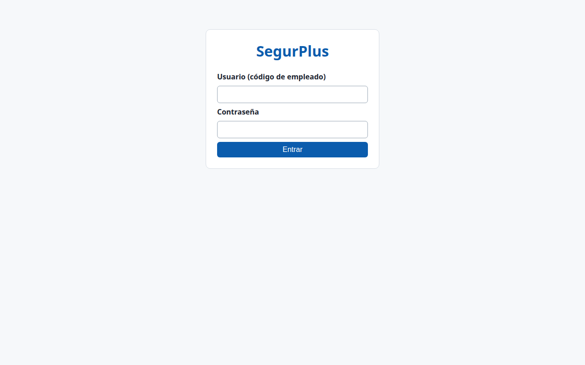
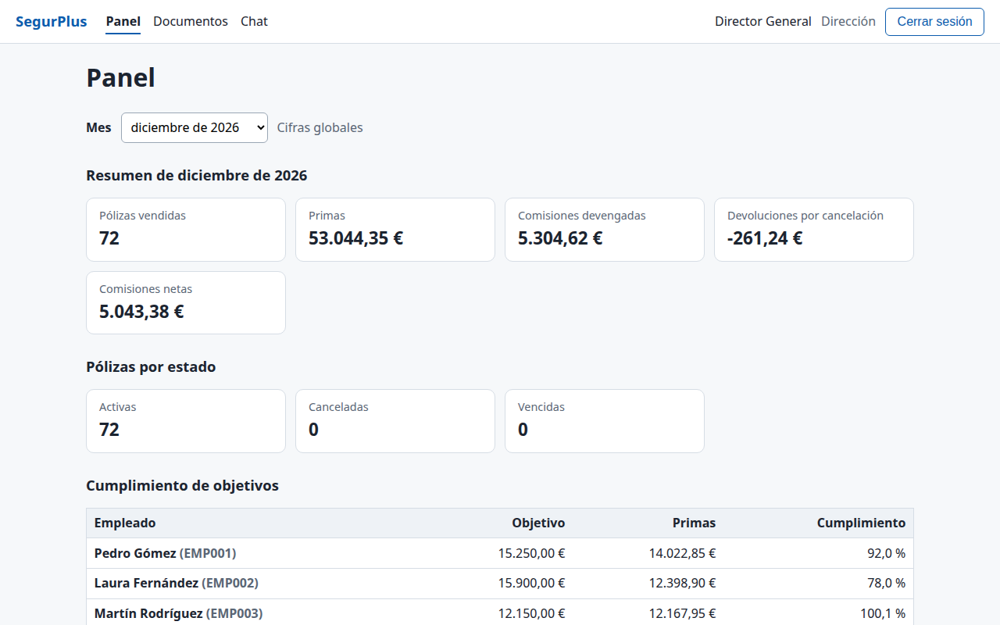
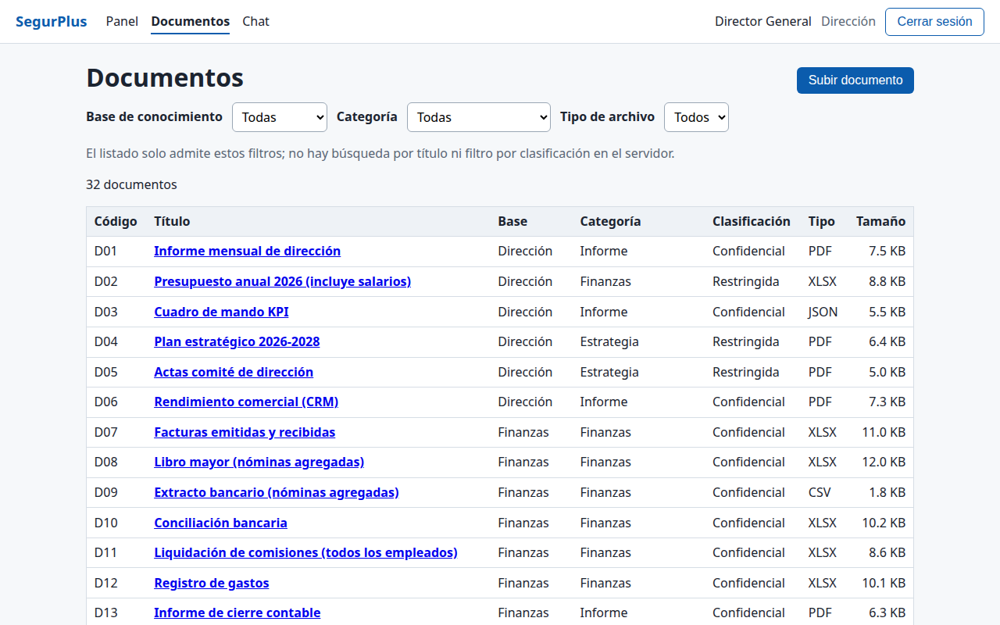
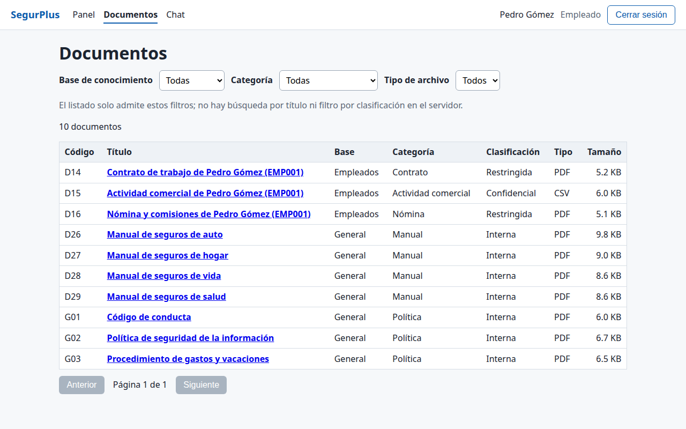
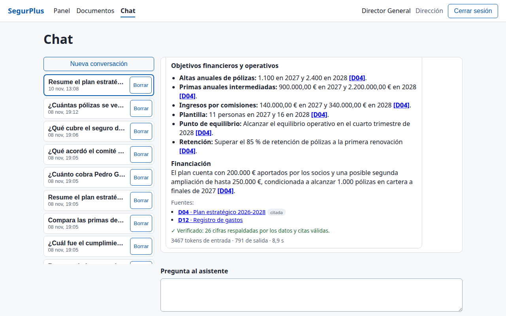
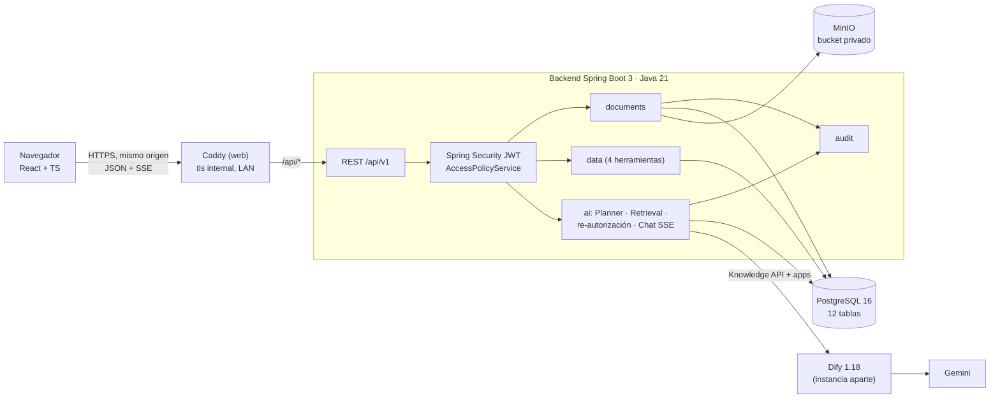

# SegurPlus

**Portfolio de seguridad y autorización con RAG con permisos.** Corredor de seguros ficticio con 7 usuarios y 4 roles; un asistente de IA (Dify + Gemini) que **solo ve lo que el usuario puede leer**: la autorización vive siempre en el backend (`AccessPolicyService`, deny by default), nunca en el frontend, en el prompt ni en Dify. Todos los datos son ficticios.

> **Todo es local.** Corre en una máquina de la LAN (`https://192.168.0.28:5174`); no hay despliegue en internet, ni dominios, ni puertos abiertos en el router. El `docker-compose` es solo empaquetado reproducible. Sin GitHub: la CI se entrega como definición de pipeline + un script local equivalente.

| Login | Panel (Dirección) |
|---|---|
|  |  |

| Documentos (Dirección: ve 32) | Documentos (EMP001: ve solo 10) |
|---|---|
|  |  |

| Chat con citas y verificación |
|---|
|  |

*(Capturas reales con Playwright + Chrome contra la instancia viva y los datos ficticios del seed; `frontend/scripts/capture-screenshots.mjs`.)*

## Qué demuestra
- **Un solo punto de decisión**: `READ`/`DOWNLOAD` si `rol ∈ documents.allowed_roles` o `owner_id = usuario`; escribir, solo MANAGER. Recurso no autorizado ⇒ **404** (indistinguible de inexistente); listados filtrados en la consulta.
- **RAG con permisos**: Dify recupera con filtro de metadatos (optimización) y el backend **re-autoriza cada fragmento** antes de que llegue al LLM; las citas se re-autorizan al enviarlas y al releerlas. Aunque el índice de Dify esté obsoleto o sea hostil, no hay fuga (fallo cerrado).
- **Identidad solo del JWT**: `employee_id`, `role`, `assistantId`, `datasetId` enviados por el cliente (o propuestos por el LLM) se ignoran y se auditan. El LLM no ejecuta SQL: solo 4 herramientas tipadas sobre los mismos servicios que el panel.
- **Sesión**: access JWT de 10-15 min en memoria + refresh opaco en cookie `HttpOnly; Secure; SameSite=Strict`, rotación en cada uso, reutilización ⇒ revocación de toda la familia, solo hash SHA-256 en BD.
- **Logs sin JWT, prompts ni contenido**; auditoría solo con metadatos; ID de correlación.

## Arquitectura

Detalle: [`docs/architecture/`](docs/architecture/README.md) (contexto, contenedores, componentes, flujo del chat, pipeline de documentos). Paquetes: `auth`, `documents`, `data`, `ai`, `audit`, `shared` ([ADR 0001](docs/adr/0001-paquetes-por-funcionalidad.md)).

## Cómo ejecutarlo
Requisitos: Docker (Compose v2), una instancia de **Dify 1.18** con Gemini (no forma parte del compose; ver [`deploy/README.md`](deploy/README.md)), y una clave de Gemini. Para probar sin Dify ni modelo existe un **Dify simulado** (perfil `mockdify`, solo demo/pruebas).

```bash
git clone <este repo> segurplus && cd segurplus
cp .env.example deploy/.env && chmod 600 deploy/.env
#   edita deploy/.env: POSTGRES_PASSWORD, MINIO_ROOT_PASSWORD, JWT_SECRET (openssl rand -base64 36)
#   y SEGURPLUS_SEED_DEFAULT_PASSWORD: la clave COMÚN de los 7 usuarios de prueba que elijas tú
#   (el .env.example trae un valor de ejemplo que debes cambiar; nunca la subas al repo)
mkdir -p deploy/data/postgres deploy/data/minio deploy/data/caddy
docker compose -f deploy/docker-compose.yml --env-file deploy/.env up -d --build      # postgres, minio, backend, web
docker compose -f deploy/docker-compose.yml --env-file deploy/.env --profile seed run --rm seed   # datos + 32 documentos (RESETEA la BD)
scripts/check-dify.sh                                                                  # verifica la dependencia de Dify
```
Abre `https://192.168.0.28:5174` (o la IP de `WEB_BIND_IP`; el navegador avisa una vez del certificado propio de Caddy). Usuarios: `DIR001` (Dirección), `ACC001` (Contabilidad), `COM001` (Dirección comercial), `EMP001`-`EMP004` (comerciales). Primera vez con Dify nuevo: `python3 deploy/dify/provision_dify.py` (proveedor Gemini, 4 bases de conocimiento, 4 apps; escribe las claves en `deploy/.env`).

Puertos (todos en `127.0.0.1`, salvo la web en la IP de la LAN): backend 8100, PostgreSQL 5434, MinIO 9000/9001, web 5174. Se reservan en el Port Panel del servidor antes de cambiarlos. Más variantes (backend como proceso del host, copia paralela, perfiles): [`deploy/README.md`](deploy/README.md).

### Probar
```bash
scripts/ci-local.sh                 # los mismos pasos que .github/workflows/ci.yml: backend, generator, frontend, compose, secretos
scripts/clone-test.sh               # clona el repo a un tmp, levanta con puertos propios + seed + checklist de 7 logins y 1 pregunta por rol, y lo desmonta
cd backend && ./mvnw verify         # JUnit + ArchUnit + Testcontainers (PostgreSQL, MinIO), Dify simulado
cd frontend && npm test             # Vitest;  npm run test:e2e = Playwright contra el stack vivo (el chat real gasta modelo: -g interceptado)
python3 evaluation/run_eval.py      # evaluación real del chat (recall@5, citas, fugas); gasta cuota de Gemini
python3 evaluation/injection/run_real.py   # 2 casos reales de prompt injection (≈4 peticiones al modelo)
```
La CI (`.github/workflows/ci.yml`) **no se ejecuta aquí** (no hay GitHub); `scripts/ci-local.sh` corre exactamente los mismos pasos y es lo que se ejecutó. Detalle: [`scripts/README.md`](scripts/README.md).

## Resultados de seguridad (build final de F6)
| Prueba | Resultado |
|---|---|
| Acceso cruzado, 7 usuarios × 32 documentos × REST, listados, RAG, citas, herramientas, descargas, conversaciones ajenas | **1 684 comprobaciones, 0 fallos** |
| Prompt injection: 12 documentos maliciosos indexados en una prueba aparte + 8 consultas hostiles, planificador y modelo simulados obedientes, 7 usuarios | **140 ejecuciones, 0 con éxito** (+ 2 casos con modelo real: 0) |
| Refresh: cookie, solo POST+cookie, reutilización ⇒ familia revocada + `TOKEN_REUSE_DETECTED`, logout, JWT alterado/caducado, solo hash | 19 tests, 0 fallos |
| Logs y auditoría sin JWT, prompts ni contenido (recorrido completo + log real) | 0 hallazgos |
| Backend completo (`./mvnw verify`) | 429 tests, 0 fallos (13 de ArchUnit) |
| Evaluación real del chat sobre la build final | **solo 10 de 32 preguntas medibles** con la cuota gratuita: recall@5 6/7 (0,857), citas válidas 7/7, fugas 0 |
| Clone limpio + compose + seed + 7 logins + 1 pregunta por rol (Dify simulado) | OK, desmontado sin restos |

Informe completo, números por canal, hallazgo F6-01 y modelo de amenazas: [`docs/security/f6-resultados.md`](docs/security/f6-resultados.md).

## Modelo de amenazas (resumen)
Amenazas consideradas: acceso a documentos ajenos por REST/listados/descargas; el mismo contenido a través del chat (índice de Dify obsoleto o hostil, citas inventadas); suplantación de identidad (campos del cliente, JWT alterado, parámetros propuestos por el LLM); robo y reutilización del refresh token; **prompt injection** en documentos y consultas (órdenes escondidas, delimitadores falsos, exfiltración por markdown, SSE falsificado); fuga por logs o auditoría; salarios por cualquier vía. Controles: política única y 404 uniforme, re-autorización de cada fragmento, identidad solo del JWT, herramientas tipadas sin SQL libre, datos del LLM delimitados con marca aleatoria y rotulados como no confiables, render sin HTML, cookie endurecida con rotación y hash, logs sin contenido. **Riesgo residual honesto**: un MANAGER es de confianza; el LLM puede escribir cosas falsas con contexto autorizado (la UI muestra la verificación como señal, no como bloqueo); sin antivirus, sin límite de intentos de login ni RLS; los datos autorizados viajan a Gemini a través de Dify; no está pensado ni probado para exponerse a internet. Tabla completa en [`docs/security/f6-resultados.md`](docs/security/f6-resultados.md#7-modelo-de-amenazas-breve).

## Decisiones principales
- Versión **simplificada** a propósito (12 tablas, 5 paquetes, 4 KBs, 4 pantallas): qué se recortó y por qué en [`docs/DECISIONES.md`](docs/DECISIONES.md).
- [ADR 0002](docs/adr/0002-abac-access-policy-service.md) política de acceso única · [0003](docs/adr/0003-dify-aigateway-recuperacion-controlada.md) Dify detrás de `AiGateway` con recuperación controlada · [0005](docs/adr/0005-herramientas-tipadas.md) herramientas tipadas · [0006](docs/adr/0006-fecha-ficticia-clock-inyectable.md) fecha ficticia (2027-01-15) · [0007](docs/adr/0007-sesiones-jwt-refresh-rotativo.md) JWT + refresh rotativo · [0008](docs/adr/0008-embedding-y-modelos-gemini.md) modelos Gemini · [0009](docs/adr/0009-verificacion-de-seguridad-f6.md) verificación de seguridad y empaquetado local (F6).
- Cuota gratuita de Gemini (≈20 peticiones/día por modelo): las pruebas de seguridad usan Dify/modelo simulado; el modelo real solo donde es imprescindible.
- Las herramientas de datos devuelven solo **totales** (sin desglose por empleado): decisión del propietario.

## Estructura
| Ruta | Contenido |
|---|---|
| `backend/` | Spring Boot (API, seguridad, IA, indexador, tests) · [`backend/README.md`](backend/README.md) |
| `frontend/` | React + TS: Login, Panel, Documentos (visor), Chat · [`frontend/README.md`](frontend/README.md) |
| `generator/` | Datos ficticios deterministas y 32 documentos (seed) · [`generator/README.md`](generator/README.md) |
| `deploy/` | Compose, Caddy, Dify (aprovisionamiento) y Dify simulado · [`deploy/README.md`](deploy/README.md) |
| `evaluation/` | 32 preguntas, evaluación real y corpus de inyección · [`evaluation/README.md`](evaluation/README.md) |
| `scripts/` | CI local, prueba de clone limpio, escaneo de secretos · [`scripts/README.md`](scripts/README.md) |
| `docs/` | Brief, arquitectura, modelo de datos, permisos, ADR, fases ([F1](docs/phases/F1-backend-base.md)–[F6](docs/phases/F6-seguridad-y-portfolio.md)), seguridad |

Convenciones para quien contribuya (o para Claude Code): [`CLAUDE.md`](CLAUDE.md). El diseño completo anterior (54 tablas, 9 KBs, 10 fases) sigue en la rama `f0-diseno`.
