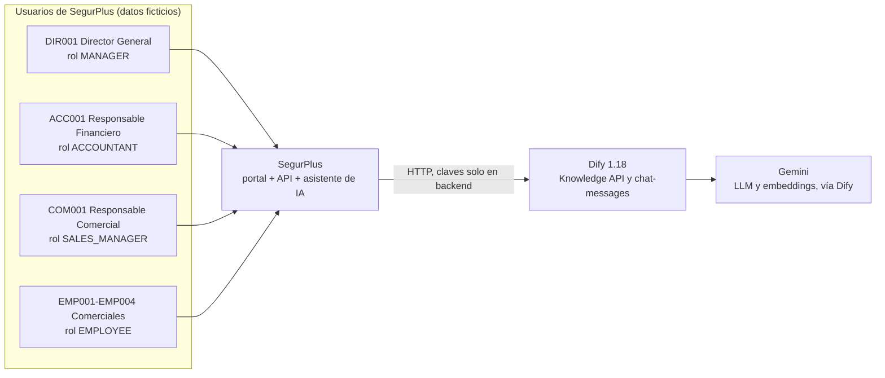

# 01 · Contexto del sistema

SegurPlus es un corredor/mediador de seguros online ficticio (A1). Siete usuarios, cuatro roles, un asistente de IA.

## Fronteras de confianza
| Frontera | Qué cruza | Control |
|---|---|---|
| Navegador → backend | JWT de acceso (10-15 min) en memoria; refresh en cookie HttpOnly/SameSite | Spring Security; identidad solo del JWT; refresh rotativo ([ADR 0007](../adr/0007-sesiones-jwt-refresh-rotativo.md)); se ignoran `employee_id`, `role`, `assistantId`, `datasetId` del cliente |
| Backend → Dify | consultas con filtros de metadatos, contexto delimitado, `user` opaco `u_<uuid>` | clave de Dify solo en backend; fragmentos re-autorizados al volver |
| Backend → MinIO | objetos privados | solo el backend tiene credenciales; descargas auditadas |
| Contenido de documentos → LLM | texto no confiable | delimitado, sin herramientas de escritura, pruebas de prompt injection (F6) |

Fuera del sistema: aseguradoras con integración real, pasarela de pago, siniestros. La aseguradora es un texto en la póliza.
