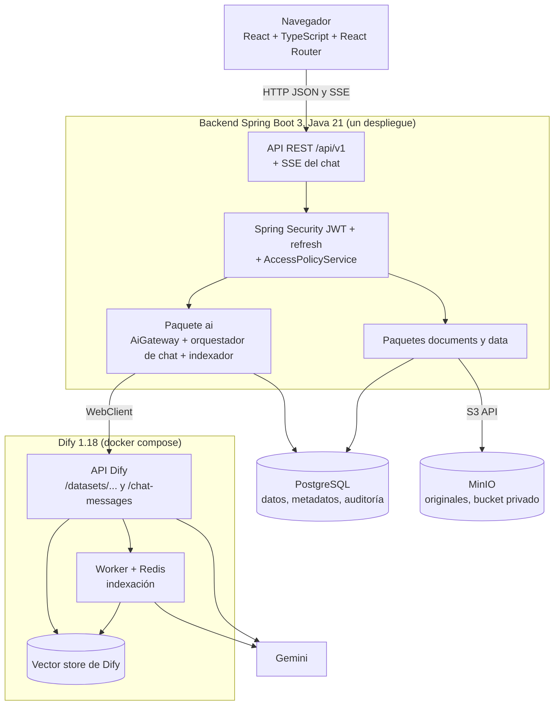

# 02 · Contenedores

| Contenedor | Tecnología | Responsabilidad | Datos que guarda |
|---|---|---|---|
| Frontend | React, TS, React Router, pdf.js | Login, Documentos, Chat, Dashboard. No decide permisos; consume SSE con `fetch` + `ReadableStream` | Nada sensible persistente |
| Backend | Spring Boot, JPA, Flyway | Lógica, política de acceso, orquestación RAG/SQL | Sin estado |
| PostgreSQL | PG 16 | **Fuente de verdad** ([schema.md](../data-model/schema.md)) | 12 tablas |
| MinIO | bucket privado | Originales de documentos | Binarios; clave `documents/<docId>/<sha256>` |
| Dify | 1.18 | Indexación, recuperación, generación | Copia derivada del texto y metadatos; reconstruible |
| Gemini | API externa | LLM; se alcanza a través de Dify | Nada nuestro |

## Despliegue local
`docker compose up -d` levanta postgres, minio, dify (api, worker, redis, vector store), backend y frontend. Secretos en `.env` no versionado. Un seed determinista (F2) reproduce el dataset. Si el stream de Dify solo emite `ping`, revisar el worker y Redis de Dify.

## Configuración relevante (nombres orientativos)
`segurplus.clock.fixed-date` (2027-01-15), `segurplus.clock.zone` (Europe/Madrid), `segurplus.dify.base-url`, claves de app y Knowledge por separado, `segurplus.ai.timeouts.*`, `segurplus.assistant.profile` (YAML con KBs y alcance de herramientas por rol).
