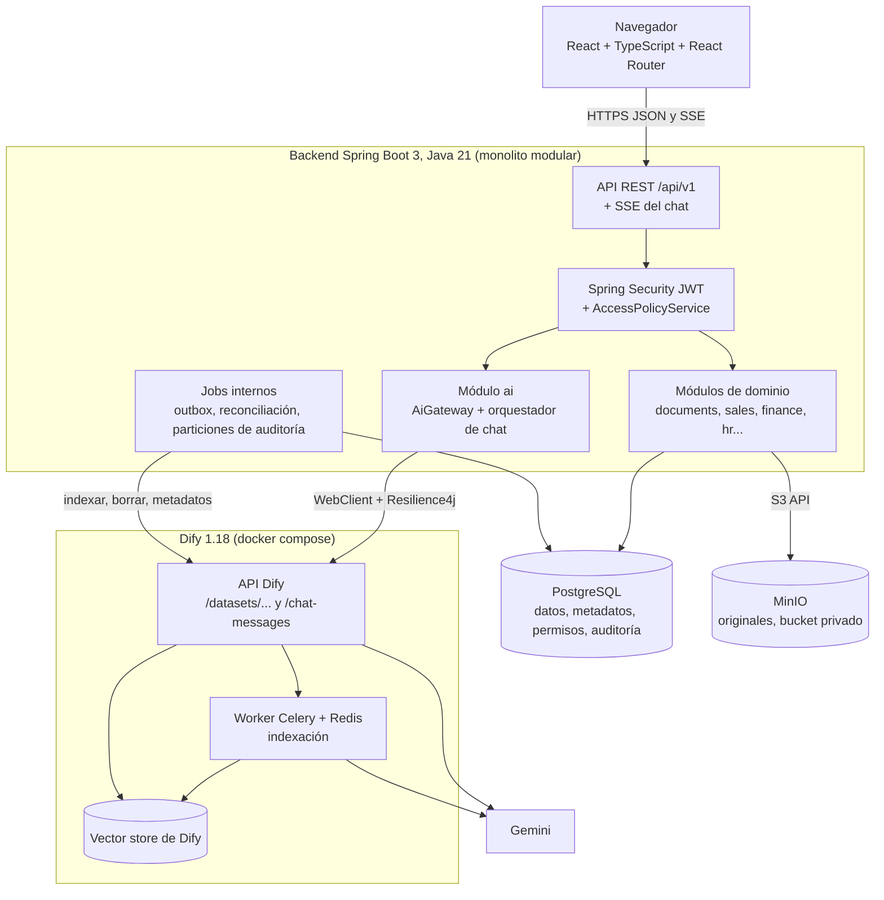

# 02 · Contenedores

| Contenedor | Tecnología | Responsabilidad | Datos que guarda |
|---|---|---|---|
| Frontend | React, TS, React Router, pdf.js | UI por rol; consume SSE con `fetch` + `ReadableStream`. No decide permisos | Nada sensible persistente |
| Backend | Spring Boot, Modulith, JPA, Flyway | Toda la lógica, política de acceso, orquestación RAG/SQL | Sin estado salvo caché corta de roles |
| PostgreSQL | PG 16+ | **Fuente de verdad** (ADR 0004). Auditoría particionada por mes | Todo el modelo ([`../data-model/schema.md`](../data-model/schema.md)) |
| MinIO | bucket privado | Originales versionados inmutables | Binarios; clave `documents/<docId>/v<n>/<sha256>` |
| Dify | 1.18 | Indexación, recuperación, generación | Copia derivada del texto y metadatos; reconstruible |
| Gemini | API externa | LLM; se alcanza a través de Dify | Nada nuestro |

## Despliegue local
`docker compose up -d` levanta postgres, minio, dify (api, worker, redis, vector store), backend y frontend. Secretos en `.env` no versionado. Un seed determinista (F2) reproduce el dataset. Si el stream de Dify solo emite `ping`, revisar worker/Celery/Redis.

## Variables de configuración relevantes (nombres orientativos)
`segurplus.clock.mode` (`FIXED`|`SYSTEM`), `segurplus.clock.fixed-date` (2027-01-15), `segurplus.clock.zone` (Europe/Madrid), `segurplus.dify.base-url`, claves de app y Knowledge por separado, `segurplus.ai.timeouts.*`, `segurplus.ai.daily-token-quota`.
