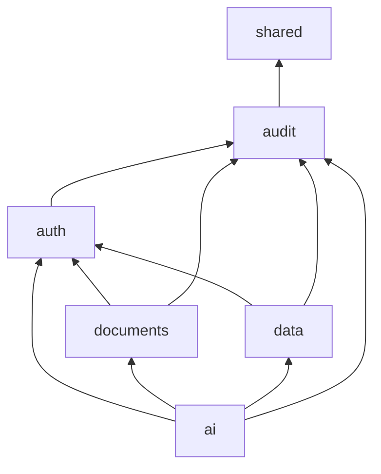
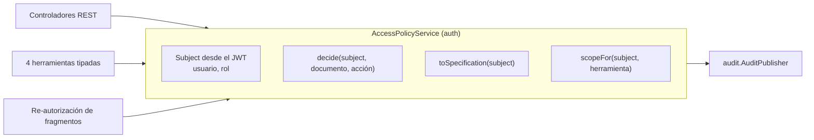

# 03 · Componentes: cinco paquetes por funcionalidad

Un único módulo Maven/Spring Boot. Paquetes bajo `com.segurplus`: `auth`, `documents`, `ai`, `data`, `audit` y `shared`. Sin Spring Modulith ([ADR 0001](../adr/0001-paquetes-por-funcionalidad.md)).

## Dependencias permitidas
`A --> B` significa «A puede usar los servicios públicos de B». El grafo es **acíclico**. Todos pueden usar `shared`.



## Responsabilidades y tablas
| Paquete | Responsabilidad | Tablas | API pública destacada |
|---|---|---|---|
| `shared` | `Clock` inyectable, errores RFC 7807, ID de correlación, `Money` | — | `Clock`, `Money`, `CorrelationId` |
| `audit` | Registro de auditoría (solo metadatos) | `audit_logs` | `AuditPublisher.record(...)` |
| `auth` | Login, JWT, `Subject` (usuario, rol), **`AccessPolicyService`** | `users` | `AccessPolicyService`, `Subject` |
| `documents` | Documentos, MinIO, preview PDF/Excel, descarga, estado de indexación | `documents` | `DocumentService` (listar, leer, descargar, subir), evento `DocumentChanged` |
| `data` | Clientes, pólizas, comisiones, finanzas, objetivos; consultas con alcance | `customers`, `policies`, `commissions`, `invoices`, `expenses`, `sales_targets` | `SalesQuery`, `CommissionQuery`, `PolicyQuery`, `TargetQuery` (alimentan dashboard y herramientas) |
| `ai` | `AiGateway` (puerto) + adaptador Dify, indexador, orquestador de chat, perfil del asistente, conversaciones | `conversations`, `messages` | `POST /api/v1/chat`, `AiGateway` |

## Convención interna de cada paquete
```
com.segurplus.<paquete>/
  api/        controladores REST + DTOs (nunca entidades)
  ...         servicios, entidades y repositorios (repositorios no públicos)
```

## Cómo se evita el ciclo documents ↔ ai
`documents` publica un evento de aplicación `DocumentChanged` (alta, cambio de metadatos, borrado) y expone `DocumentService`. `ai` lo escucha para indexar en Dify y consulta `DocumentService` para re-autorizar fragmentos. `documents` no conoce a `ai`.

## Componente central: política de acceso

Reglas: [ADR 0002](../adr/0002-abac-access-policy-service.md).

## Reglas de verificación (tests; ArchUnit opcional)
- Sin ciclos entre paquetes y sin acceso a repositorios de otro paquete.
- Ninguna clase fuera de `shared` usa `Instant.now()`, `LocalDate.now()` ni `Clock.systemUTC()` directamente (ADR 0006).
- Los controladores solo devuelven DTOs.
- Los repositorios de `documents` y `data` no son públicos: las consultas con alcance pasan por servicios que reciben un `Subject`.
