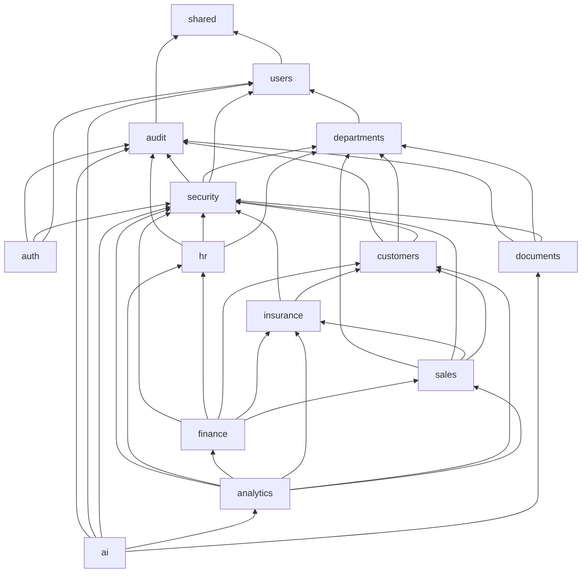
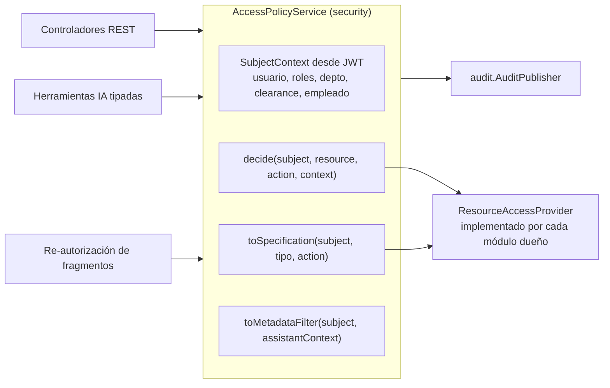

# 03 · Componentes: módulos Spring Modulith

Paquete por módulo: `com.segurplus.<modulo>/{api,application,domain,infrastructure}`. Un módulo solo usa la API pública (raíz o `api`) de otro. Se verifica con `ApplicationModules.verify()` y reglas ArchUnit (ADR 0001).

## Dependencias permitidas
`A --> B` significa «A puede usar la API pública de B». El grafo es **acíclico**; los ciclos naturales se rompen con eventos o con puertos (SPI) definidos en el módulo de menor nivel.

(Todos los módulos pueden usar además `shared`; se omite para legibilidad. La flecha a `audit` se omite en los módulos de dominio que solo publican eventos de auditoría vía `shared`/`audit.api`.)

## Responsabilidades y tablas propias
| Módulo | Responsabilidad | Tablas (ver schema.md) | API pública destacada |
|---|---|---|---|
| `shared` | Kernel: `BusinessClock`/`SystemClock`, `Money`, IDs, errores RFC 7807, outbox | `outbox_events` | `Money`, `CorrelationId`, `OutboxPublisher` |
| `audit` | Registro de auditoría append-only (solo metadatos) | `audit_logs` | `AuditPublisher.record(AuditEvent)` |
| `users` | Usuarios, roles, permisos de datos | `users`, `roles`, `permissions`, `user_roles`, `role_permissions` | `UserDirectory`, `RoleCatalog` |
| `departments` | Estructura organizativa y empleados | `departments`, `employees` | `EmployeeDirectory` (incluye «equipo» de un responsable) |
| `security` | `AccessPolicyService` (ABAC), contexto, SPI de recursos | — (la política es código; los datos están en `users` y en cada módulo) | `AccessPolicyService`, SPI `ResourceAccessProvider` |
| `auth` | Login, JWT, refresh con rotación | `refresh_tokens` | endpoints `/api/v1/auth/*` |
| `documents` | Documentos, versiones, grants, KBs, MinIO, estados de indexación | `document_classifications`, `document_categories`, `knowledge_bases`, `documents`, `document_versions`, `document_permissions` | `DocumentQueryService`, `DocumentIndexingApi`, eventos `Document*` |
| `ai` | `AiGateway` (puerto) + adaptador Dify, orquestador de chat, asistentes, conversaciones, costes, evaluación | `ai_tools`, `ai_assistants`, `ai_assistant_knowledge_bases`, `ai_assistant_tools`, `conversations`, `messages`, `message_sources`, `message_tool_calls`, `ai_model_prices`, `ai_evaluation_*` | `POST /api/v1/chat`, `AiGateway` |
| `analytics` | Servicios de consulta con alcance; dashboards; **fuente única** de las herramientas SQL | (vistas, sin tablas propias) | `SalesAnalytics`, `CommissionAnalytics`, `PolicyAnalytics`, `ObjectiveAnalytics`, `FinanceAnalytics`, `PeriodComparison` |
| `customers` | Clientes | `customers` | `CustomerQueryService` |
| `insurance` | Aseguradoras, productos, pólizas, coberturas, renovaciones, cancelaciones | `insurance_*`, `policies`, `policy_*` | `PolicyIssuer`, `PolicyQueryService` |
| `sales` | Leads, oportunidades, ventas, actividades | `leads`, `opportunities`, `sales`, `sales_activities` | `SaleRegistry`, evento `SaleConfirmed` |
| `finance` | Libro mayor, facturas, pagos, gastos, comisiones | `accounting_*`, `expense_categories`, `expenses`, `invoices`, `insurer_commissions`, `payments`, `commissions` | `LedgerPoster`, `CommissionCalculator` |
| `hr` | Contratos, nóminas, objetivos, evaluaciones, ausencias | `employment_contracts`, `payroll_runs`, `payroll`, `sales_targets`, `performance_reviews`, `leave_requests` | `TargetQuery`, SPI `CommissionTotalsProvider`, evento `PayrollApproved` |

## Cómo se rompen los ciclos
| Ciclo aparente | Solución |
|---|---|
| `documents` ↔ `ai` (indexar en Dify vs. citar documentos) | `documents` publica eventos (`DocumentIndexRequested`, `DocumentDeleted`, `DocumentMetadataChanged`) y expone `DocumentIndexingApi`; `ai` los consume y llama a la API. `documents` no conoce a `ai`. |
| `security` ↔ `documents` (la política necesita atributos y grants) | `security` define el SPI `ResourceAccessProvider` (qué grants/atributos aplican y cómo se traducen a `Specification`); `documents` lo implementa. `security` no depende de `documents`. |
| `sales` ↔ `insurance` | `sales` llama a `PolicyIssuer` de `insurance`; `insurance` no conoce `sales` (guarda `sale_id` como identificador). |
| `finance` ↔ `hr` | `finance` depende de `hr` (tasa de comisión del contrato; SPI `CommissionTotalsProvider` implementado en `finance`); `hr` publica `PayrollApproved` y `finance` contabiliza la línea agregada «Sueldos y salarios» (A5). |

## Componente central: política de acceso

Reglas de evaluación, traducción a JPA `Specification` y a filtros de metadatos de Dify: [ADR 0002](../adr/0002-abac-access-policy-service.md).

## Reglas de verificación (tests de arquitectura)
- `ApplicationModules.of(SegurPlusApplication.class).verify()` sin ciclos ni accesos a `infrastructure` ajena.
- Ninguna clase fuera de `shared` usa `Instant.now()`, `LocalDate.now()` o `Clock.systemUTC()` directamente (ADR 0006).
- Los controladores solo devuelven DTOs; ninguna entidad JPA en `api`.
- Ningún repositorio de `documents`, `customers`, `sales`, `finance`, `hr` es público: las consultas con alcance pasan por servicios que aceptan un `SubjectContext`.
