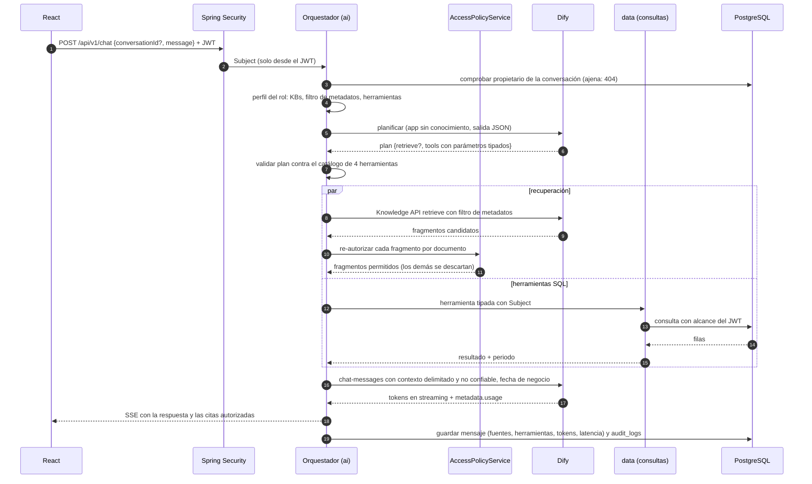

# 04 · Flujo del chat

Endpoint: `POST /api/v1/chat` (`{conversationId?, message}`, respuesta SSE). Un solo asistente: el backend deriva del rol del JWT qué KBs y herramientas usa.

## Detalle por paso
| # | Paso | Diseño | Control |
|---|---|---|---|
| 1 | Entrada | DTO sin campos de identidad; si llegan `employee_id`, `role`, `assistantId`, `datasetId` se ignoran (evento `IGNORED_CLIENT_FIELD`) | CA-3 |
| 2 | Perfil | `assistant_profile[rol]` (YAML): KBs y filtro; `promptVars.today` = fecha de negocio (ADR 0006) | Conversación ajena ⇒ 404 |
| 3 | Planificación | Llamada a una app de Dify sin conocimiento; salida JSON validada; el LLM nunca ve ni propone `employee_id` | ADR 0005 |
| 4 | Ejecución | RAG: filtro (optimización) + re-autorización por fragmento (control). SQL: servicios de `data` con alcance del JWT | ADR 0002, 0003 |
| 5 | Generación | Bloques delimitados con marca «DATOS NO CONFIABLES»; la app de generación **no** tiene nodo de conocimiento | Mitiga prompt injection |
| 6 | Streaming | `text/event-stream`; al terminar, evento final `verification` (cifras ∈ salidas de herramientas, citas ∈ fragmentos autorizados) | Ver abajo |
| 7 | Persistencia | `messages` (fuentes, herramientas, tokens, latencia) y `audit_logs` (solo metadatos) | Sin contenido en auditoría ni logs |

## Verificación y streaming
La respuesta se emite en streaming real. El LLM solo ha visto texto ya autorizado, así que no puede filtrar lo que no recibió; la verificación de cifras y citas es una **señal de calidad** que se emite como evento final y se guarda en el mensaje, no un bloqueo previo. Las citas que llegan al cliente son solo las de fragmentos autorizados.

## Plazos y errores
Conexión 3 s, primera respuesta 10 s, inactividad 30 s, tope 120 s. Un reintento solo **antes del primer token**. Errores al cliente en RFC 7807 sin detalle interno de Dify. Estados de `messages.status`: `PENDING → STREAMING → COMPLETED`, o `FAILED`, `CANCELLED` (el cliente cierra el SSE). Si el stream solo emite `ping`, revisar el worker de Dify.

## Variante rechazada
Recuperar dentro del chatflow de Dify con filtros por `inputs` es detección, no prevención (con streaming no se puede retirar lo ya emitido).
