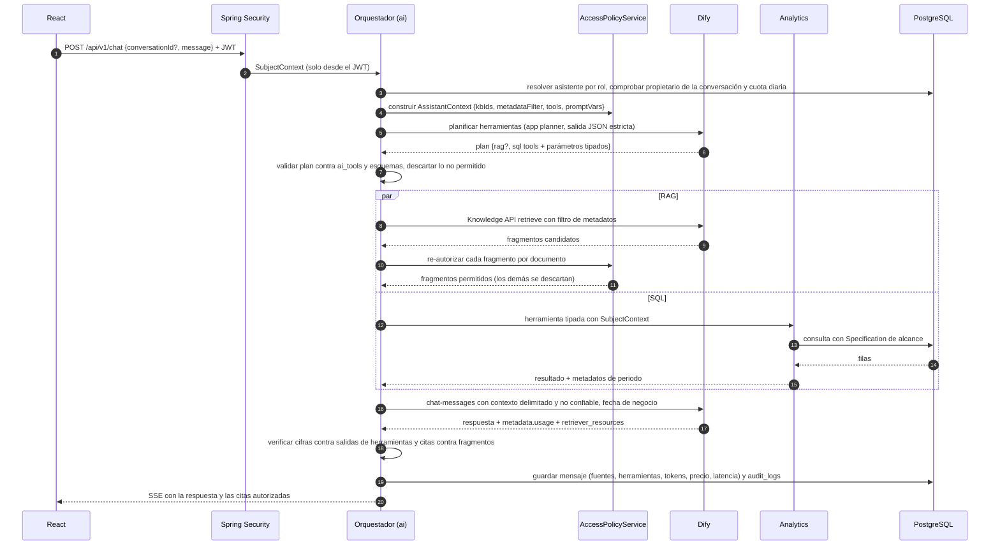

# 04 · Flujo del chat

Implementa los 8 pasos del brief §5. Endpoint: `POST /api/v1/chat` (el brief escribe `/api/chat`; CLAUDE.md fija `/api/v1`; ver H-30 en [F0-hallazgos](../F0-hallazgos.md)).

## Detalle por paso del brief
| # | Brief | Diseño | Control de seguridad |
|---|---|---|---|
| 1 | React envía `{conversationId?, message}` + JWT | DTO sin campos de identidad; si llegan `employee_id`, `role`, `assistantId`, `datasetId` se ignoran (se puede registrar un evento de auditoría `IGNORED_CLIENT_FIELD`) | Criterio 4 |
| 2 | Identidad y `AssistantContext{kbIds, metadataFilter, tools, promptVars}` | Asistente = `ai_assistants` del rol del JWT. `kbIds` se resuelve desde `ai_assistant_knowledge_bases` (incluye selectores `OWN_EMPLOYEE_KB`, `ALL_EMPLOYEE_KBS` + categoría). `promptVars` incluye la fecha de negocio (ADR 0006) | Conversación ajena → 404 |
| 3 | El LLM propone herramientas | Llamada de **planificación** a una app Dify sin acceso a conocimiento. Salida JSON validada contra `ai_tools.input_schema`; el LLM nunca ve ni propone `employee_id` | H-10 |
| 4 | Autoriza y ejecuta | RAG: filtro de metadatos (optimización) + re-autorización de cada fragmento (control). SQL: servicios de `analytics` con alcance del JWT | ADR 0002, 0003, 0005 |
| 5 | Contexto delimitado a `chat-messages` | Bloques con delimitadores y marca «DATOS NO CONFIABLES»; el chatflow de generación **no** tiene nodo de conocimiento (recuperación controlada por el backend) | Mitiga prompt injection |
| 6 | Verificar cifras y citas | Cada número de la respuesta debe estar en la salida de una herramienta; cada cita en un fragmento autorizado | H-11 (verificación vs. streaming) |
| 7 | Guardar mensaje y auditoría | `messages`, `message_sources`, `message_tool_calls`, `audit_logs` (solo metadatos) | Sin contenido en `audit_logs` ni en logs |
| 8 | Streaming SSE | `text/event-stream`; el cliente usa `fetch` + `ReadableStream` | Ver tabla de verificación |

## Verificación y streaming (decisión pendiente, H-11)
El paso 6 exige comprobar cifras antes de entregar; el paso 8 exige streaming. Propuesta por defecto, a confirmar:
- Respuestas con **resultado de herramienta SQL**: se genera en modo bloqueante, se verifica y se emite por SSE (streaming simulado por trozos).
- Respuestas **solo documentales**: streaming real; la verificación de citas se hace sobre los fragmentos ya autorizados (el LLM solo ha visto texto autorizado, así que no puede filtrar lo que no recibió) y se añade un evento final `verification` con el resultado.

## Plazos y errores (brief §5)
| Concepto | Valor |
|---|---|
| Conexión | 3 s |
| Primera respuesta | 10 s |
| Inactividad entre eventos | 30-60 s |
| Tope total | 120 s |
| Reintentos | solo **antes del primer token** |
| Resilience4j | circuit breaker + bulkhead por destino (planner, retrieve, generate) |
| Fallback | modelo de reserva configurable (`ai_assistants.fallback_model`); `messages.fallback_used` |
| Errores al cliente | RFC 7807, sin detalle interno de Dify |

Estados de `messages.status`: `PENDING → STREAMING → COMPLETED`, o `FAILED`, `CANCELLED` (cliente cierra SSE), `BLOCKED` (cuota o política).

## Costes y cuota
`metadata.usage` de Dify (tokens) se suma entre las llamadas del turno (planificación + generación) y se guarda en el mensaje del asistente; el precio lo calcula SegurPlus con `ai_model_prices` vigente en la fecha de sistema. La cuota diaria por usuario se evalúa **antes** del paso 3 con la fecha de negocio.

## Variante A (rechazada por defecto)
Recuperar dentro del chatflow de Dify con filtros por `inputs` es detección, no prevención (no se puede retirar lo ya emitido por streaming). Solo se aceptaría con decisión explícita del propietario y ADR propio.
