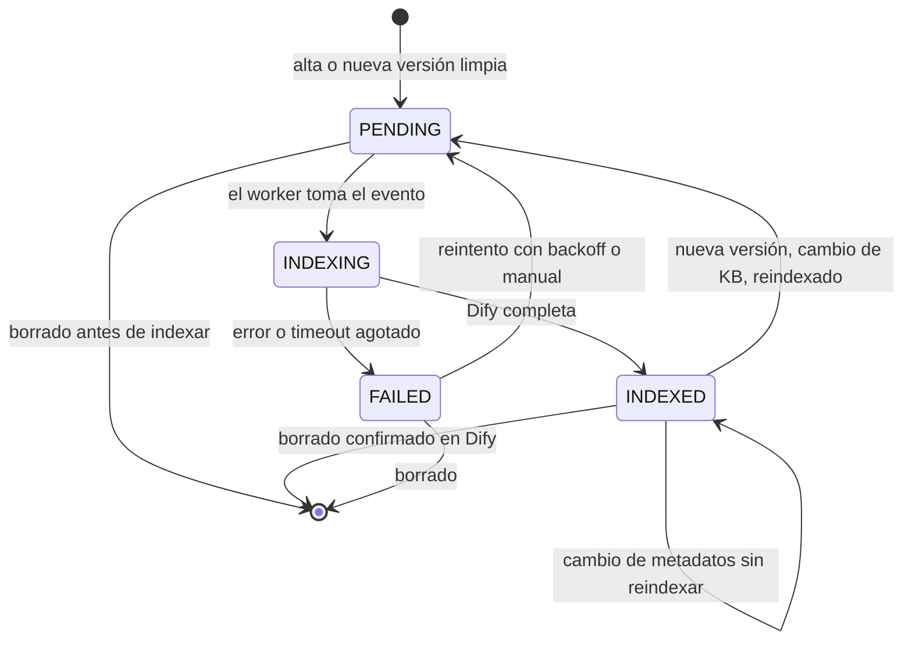
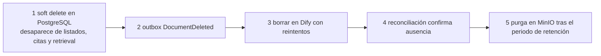

# 05 · Pipeline de documentos: tres almacenes

| Almacén | Qué guarda | Rol | Quién lo escribe |
|---|---|---|---|
| **PostgreSQL** | Metadatos, versiones, checksum, clasificación, propietario, grants, estado de indexación, auditoría | **Fuente de verdad**. Aquí se decide y se registra todo | Módulo `documents` |
| **MinIO** | Binario original de cada versión (inmutable) | Almacén de contenido; bucket privado, acceso solo del backend | Módulo `documents` |
| **Dify** | Texto troceado, embeddings y metadatos de recuperación | Copia **derivada y reconstruible** para búsqueda | Adaptador Dify del módulo `ai` |

Decisiones y reglas: [ADR 0004](../adr/0004-pipeline-tres-almacenes.md). Esta página muestra las vistas.

## Subida y indexación
```mermaid
sequenceDiagram
  autonumber
  participant U as Usuario con CREATE/UPDATE
  participant DOC as documents
  participant M as MinIO
  participant PG as PostgreSQL
  participant OB as Outbox
  participant AI as ai (adaptador Dify)
  participant D as Dify

  U->>DOC: subir fichero (multipart)
  DOC->>DOC: validar MIME real, tamaño y extensión; calcular SHA-256
  DOC->>M: PUT objeto inmutable documents/docId/vN/sha256
  DOC->>PG: INSERT documents + document_versions (scan PENDING, index PENDING) + grants iniciales + outbox
  DOC->>DOC: escaneo antivirus de la versión
  alt limpio
    DOC->>PG: scan_status CLEAN, outbox DocumentIndexRequested
    OB->>AI: entrega at-least-once
    AI->>M: leer objeto (vía documents API)
    AI->>D: crear o actualizar documento con metadatos
    AI->>PG: estado INDEXING con dify_document_id
    loop sondeo de estado de indexación
      AI->>D: indexing-status
    end
    AI->>PG: estado INDEXED, indexed_version_id, indexed_at
  else infectado
    DOC->>PG: scan_status INFECTED, nunca se indexa
  end
```

## Máquina de estados de `documents.index_status`

Los cuatro estados son los del brief. El escaneo (`scan_status`), el borrado (`deleted_at`) y la sincronía de metadatos (`dify_metadata_synced`) son campos aparte para no mezclar ejes.

## Qué se propaga a Dify y qué no
| Evento | PostgreSQL | MinIO | Dify |
|---|---|---|---|
| Nueva versión | nueva fila `document_versions`; `current_version_id` | objeto nuevo, el anterior se conserva | actualizar por fichero; estado vuelve a `PENDING` |
| Cambio de **grants** (alta, baja, caducidad) | `document_permissions` | — | **nada**: los grants no viven en Dify; la re-autorización en consulta los aplica al instante |
| Cambio de clasificación, propietario o categoría | `documents` | — | actualizar metadatos (`dify_metadata_synced=false` hasta confirmar); mientras tanto manda la re-autorización |
| Cambio de KB | `documents` | — | borrar en dataset origen y crear en destino (nuevo `dify_document_id`) |
| Borrado | `deleted_at` inmediato (invisible ya) | retención y purga diferida | borrar documento; reintento hasta confirmar |
| Reindexado manual | — | — | recrear; estado `PENDING` |

## Borrado seguro (orden)

Un fragmento devuelto por Dify cuyo `document_id` está borrado o no mapea a `documents.id` se **descarta** (fallo cerrado).

## Reconciliación
Job periódico (también bajo demanda) que compara `documents` con la lista de documentos de cada dataset de Dify:
- En Dify y no en BD, o borrado en BD → borrar en Dify (huérfano).
- En BD `INDEXED` y ausente en Dify → `PENDING`.
- `indexed_version_id <> current_version_id` → `PENDING`.
- `dify_metadata_synced=false` con antigüedad > umbral → reenviar metadatos.
Cada ejecución deja un resumen en `audit_logs` (contadores, sin contenido).

## Prueba de integridad (CA-8 y F3)
`checksum_sha256` en `documents` debe igualar el de `current_version_id`; el objeto de MinIO debe hashear a ese valor. Un test recorre los tres almacenes del dataset sembrado y comprueba la coherencia.
