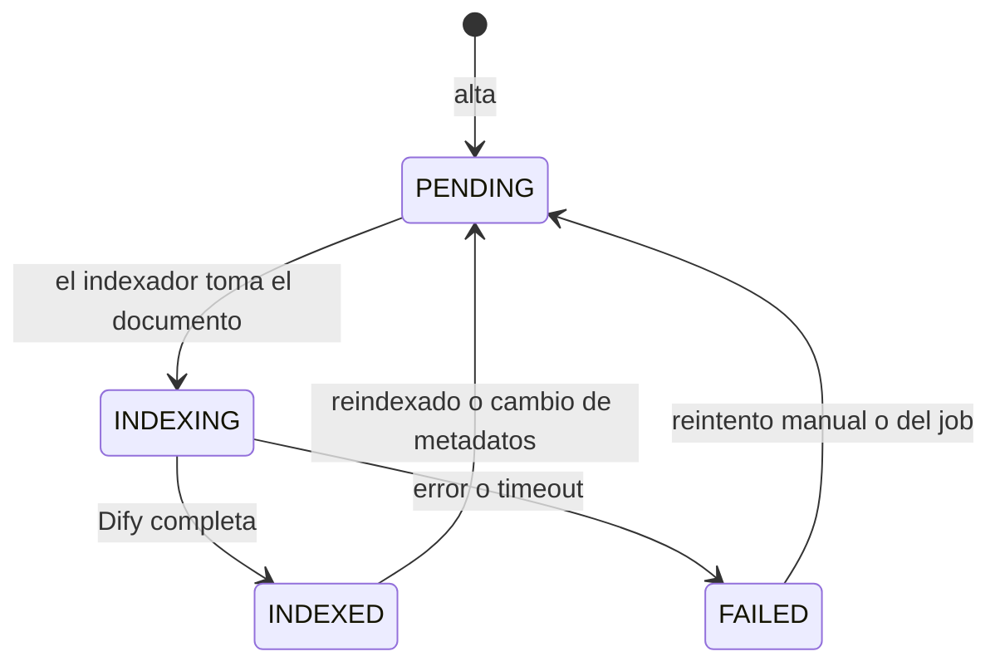

# 05 · Pipeline de documentos

| Almacén | Qué guarda | Rol | Quién lo escribe |
|---|---|---|---|
| **PostgreSQL** | Metadatos, `allowed_roles`, propietario, checksum, estado de indexación | **Fuente de verdad** | Paquete `documents` |
| **MinIO** | Binario original (bucket privado) | Contenido | Paquete `documents` |
| **Dify** | Texto troceado, embeddings y metadatos de recuperación | Copia **derivada y reconstruible** | Paquete `ai` (indexador) |

Decisiones: [ADR 0004](../adr/0004-pipeline-simplificado.md).

## Subida e indexación
```mermaid
sequenceDiagram
  autonumber
  participant U as MANAGER
  participant DOC as documents
  participant M as MinIO
  participant PG as PostgreSQL
  participant AI as ai (indexador)
  participant D as Dify

  U->>DOC: subir fichero (multipart)
  DOC->>DOC: validar MIME real, tamaño y extensión; SHA-256
  DOC->>M: PUT objeto documents/docId/sha256
  DOC->>PG: INSERT documents (index_status PENDING)
  DOC-->>AI: evento DocumentChanged
  AI->>D: crear documento en el dataset de su KB con metadatos
  AI->>PG: INDEXING con dify_document_id
  loop sondeo
    AI->>D: indexing-status
  end
  AI->>PG: INDEXED, indexed_at
```
La carga inicial (seed de F2/F3) usa el mismo camino por un comando de administración.

## Estados de `documents.index_status`

Cuatro estados. El borrado es `deleted_at` aparte (no es un estado).

## Qué se propaga a Dify
| Evento | PostgreSQL | Dify |
|---|---|---|
| Alta | fila `PENDING` | crear documento con metadatos |
| Cambio de `allowed_roles`, `owner_id`, KB o clasificación | `documents` | actualizar metadatos (o reindexar); **mientras tanto manda la re-autorización** |
| Borrado | `deleted_at` inmediato (ya invisible en listados, citas y recuperación) | borrar documento (reintento en el job) |
| Reindexado | `PENDING` | recrear |

Un fragmento devuelto por Dify cuyo `document_id` no mapea a un documento vivo se **descarta** (fallo cerrado).

## Job de reintento
Cada pocos minutos: documentos `FAILED` o `PENDING` antiguos pasan por el indexador; borrados lógicos aún presentes en Dify se eliminan. Sin outbox, sin reconciliación completa (mejora opcional).

## Prueba de integridad
`checksum_sha256` en `documents` debe igualar el hash del objeto en MinIO. Un test recorre el dataset sembrado y comprueba la coherencia.
