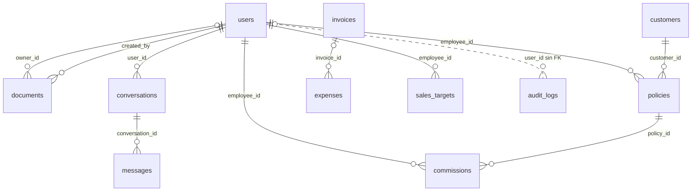
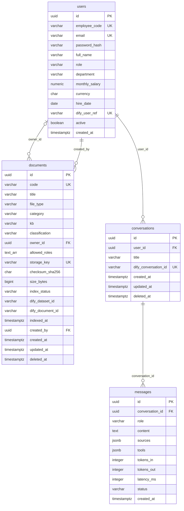
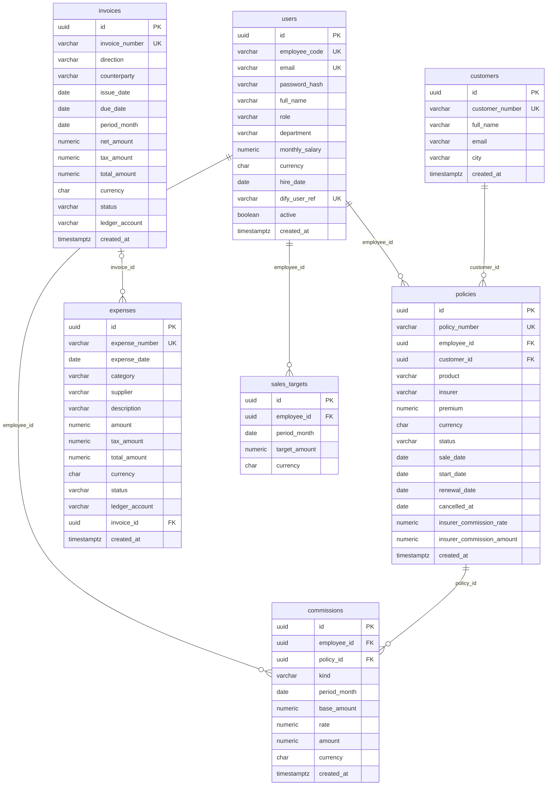
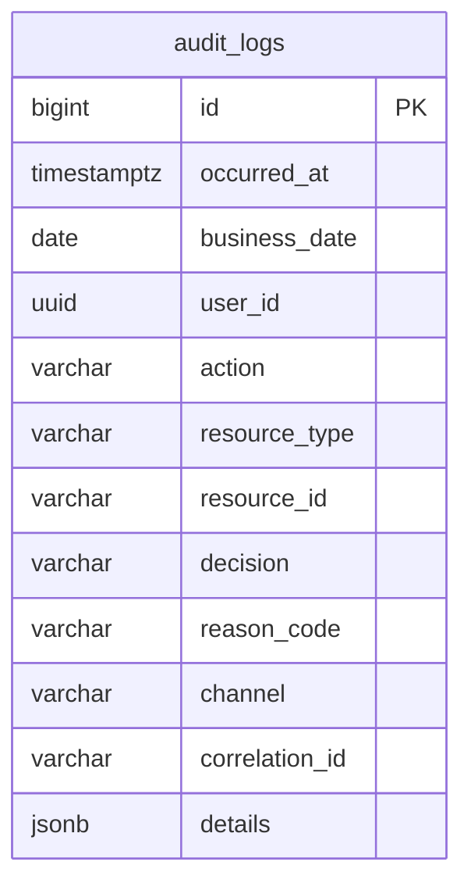

# ERD de SegurPlus

Generado a partir de [schema.md](schema.md) (11 tablas) con un script auxiliar no versionado; si cambia schema.md hay que regenerarlo o actualizarlo a mano.
Notación Mermaid: `||` exactamente uno, `|o` cero o uno, `}o` cero o muchos. `audit_logs.user_id` es una referencia lógica sin FK (punteada).

## Vista general (solo relaciones)

## Usuarios, documentos y conversaciones

## Datos de negocio

## Auditoría

