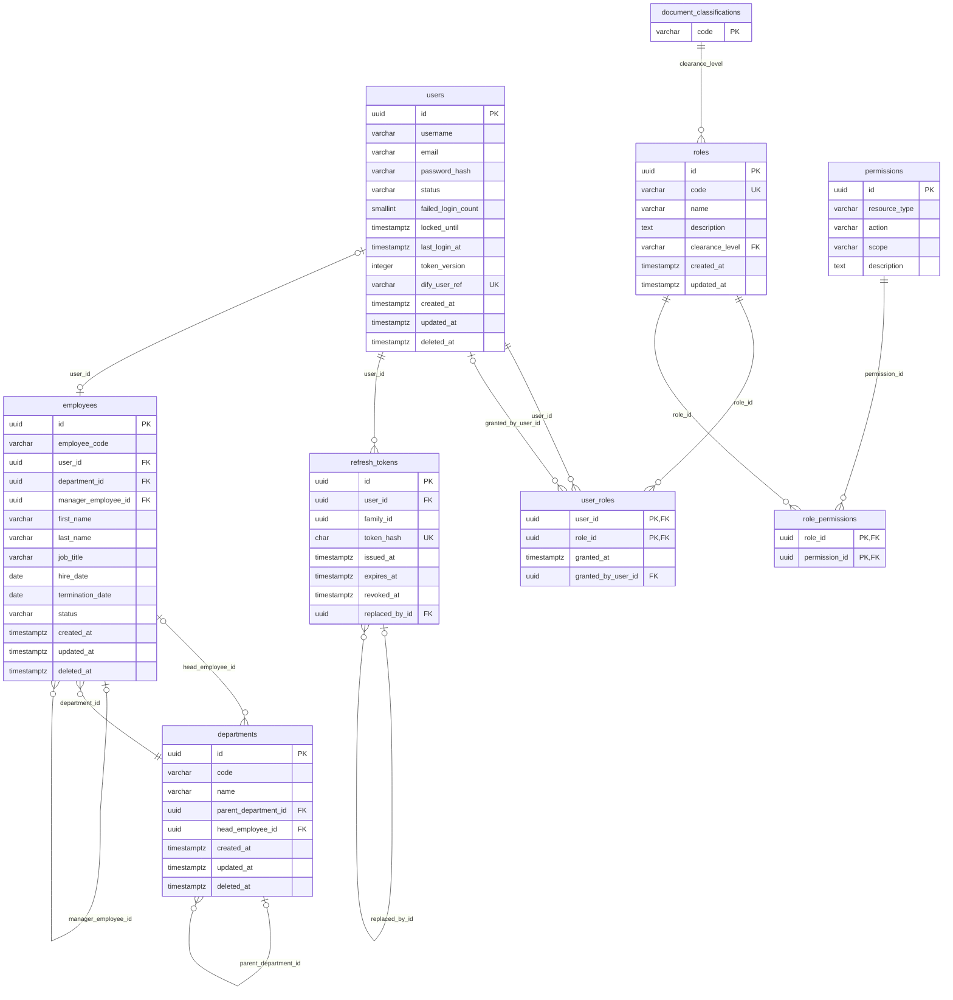
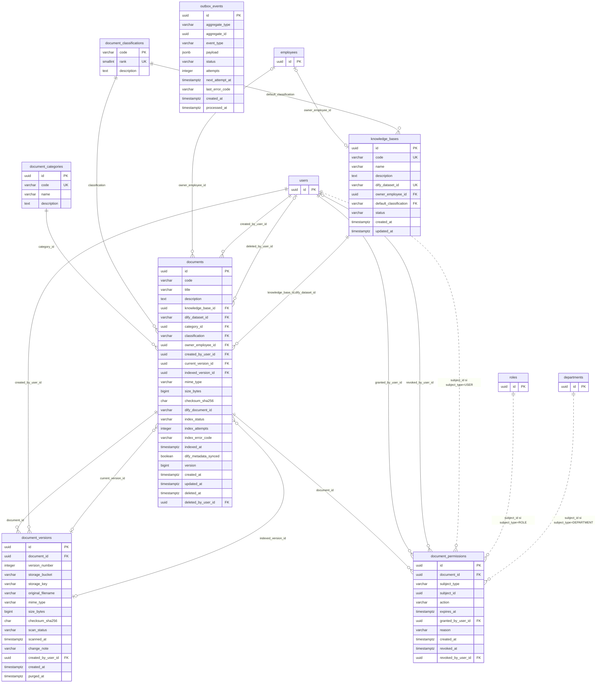
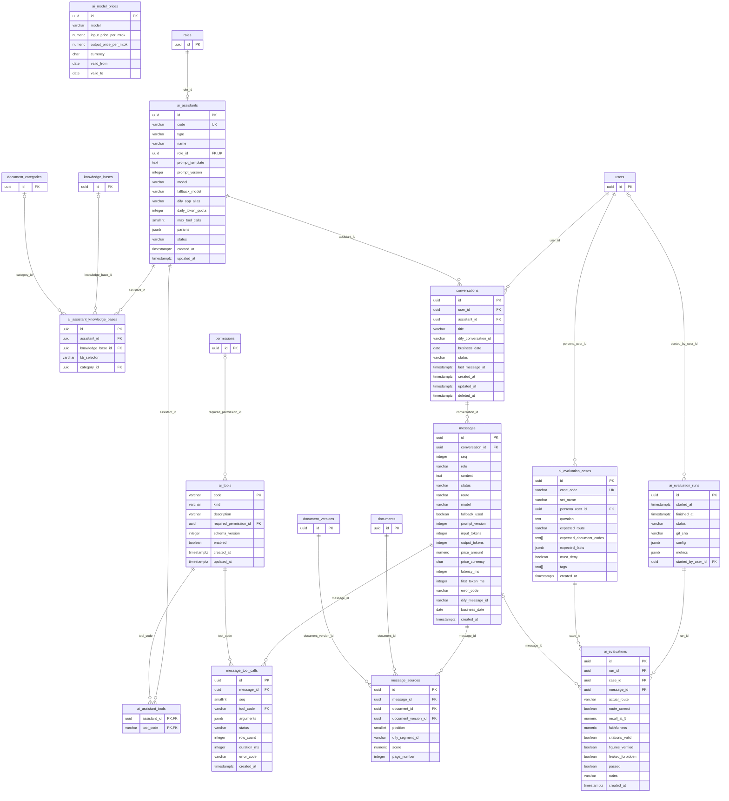
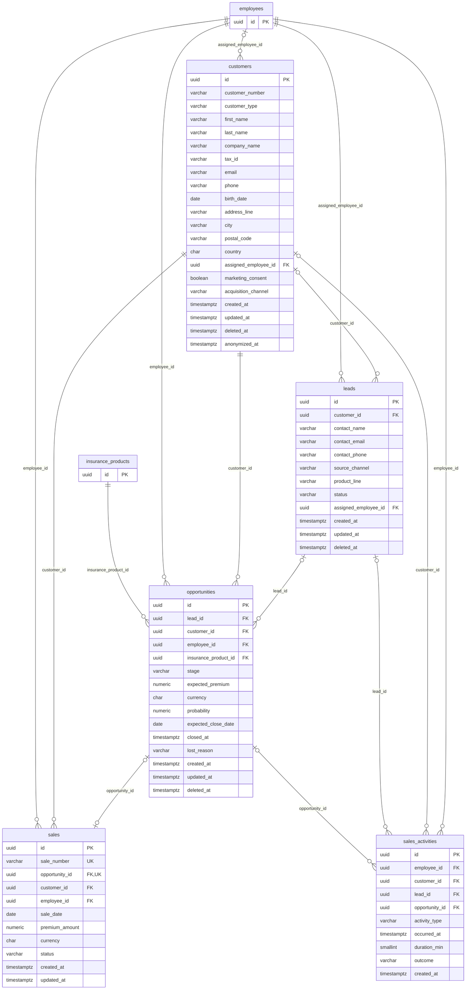
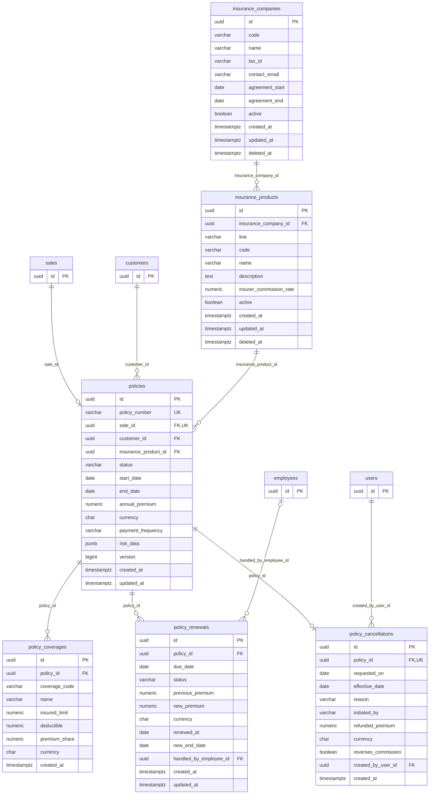
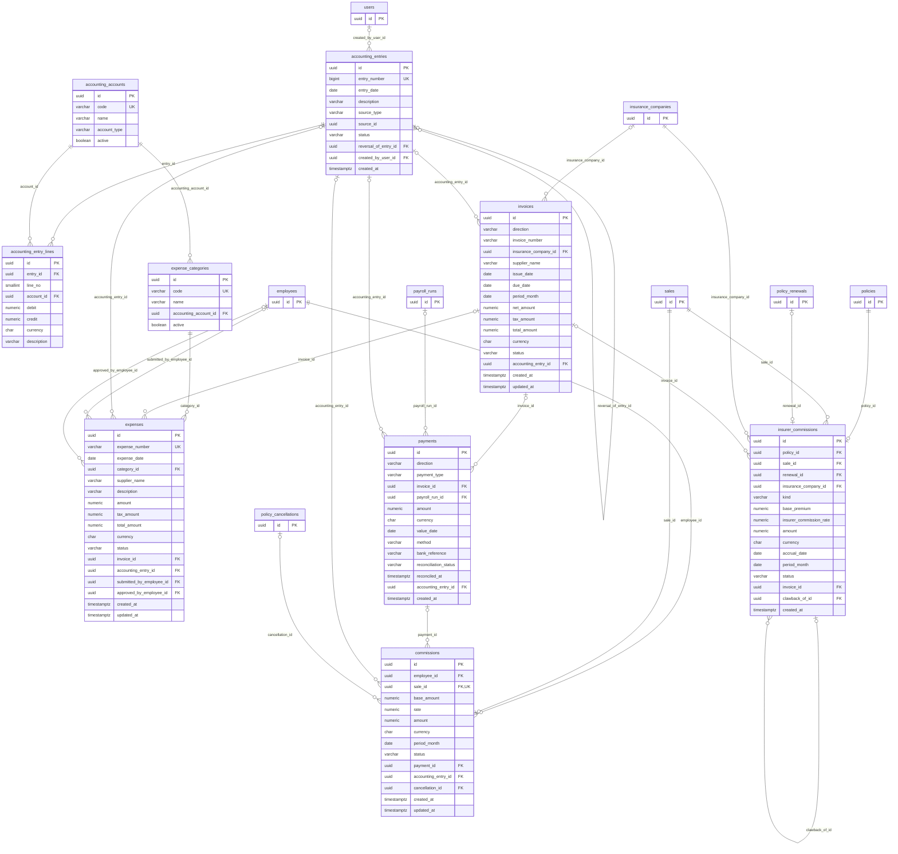
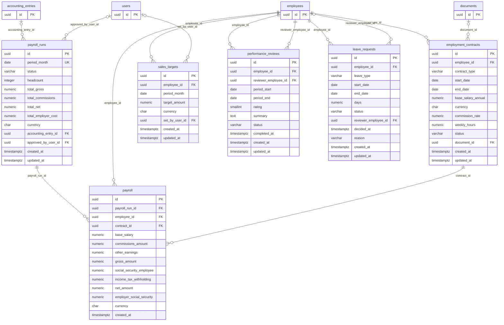
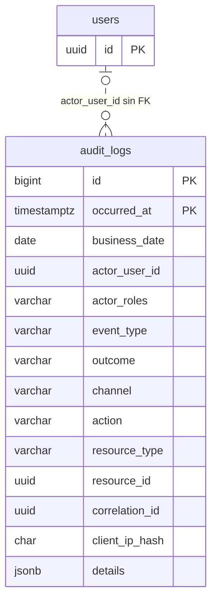

# ERD de SegurPlus

Generado a partir de [schema.md](schema.md) (54 tablas). Generado con un script auxiliar de F0 (no versionado); si cambia schema.md hay que regenerarlo o actualizarlo a mano.
Notación Mermaid: `||` exactamente uno, `|o` cero o uno, `}o` cero o muchos; línea continua = FK real, punteada = referencia lógica sin FK (polimórfica o de auditoría).
Las entidades marcadas solo con `id` en un diagrama de dominio son tablas de otro dominio (referencia).

## Vista general (solo relaciones)

```mermaid
erDiagram
  document_classifications ||--o{ roles : "clearance_level"
  users ||--o{ user_roles : "user_id"
  roles ||--o{ user_roles : "role_id"
  users |o--o{ user_roles : "granted_by_user_id"
  roles ||--o{ role_permissions : "role_id"
  permissions ||--o{ role_permissions : "permission_id"
  users ||--o{ refresh_tokens : "user_id"
  refresh_tokens |o--o{ refresh_tokens : "replaced_by_id"
  departments |o--o{ departments : "parent_department_id"
  employees |o--o{ departments : "head_employee_id"
  users |o--o| employees : "user_id"
  departments ||--o{ employees : "department_id"
  employees |o--o{ employees : "manager_employee_id"
  employees |o--o| knowledge_bases : "owner_employee_id"
  document_classifications ||--o{ knowledge_bases : "default_classification"
  document_categories ||--o{ documents : "category_id"
  document_classifications ||--o{ documents : "classification"
  employees |o--o{ documents : "owner_employee_id"
  users ||--o{ documents : "created_by_user_id"
  document_versions |o--o{ documents : "current_version_id"
  document_versions |o--o{ documents : "indexed_version_id"
  users |o--o{ documents : "deleted_by_user_id"
  knowledge_bases ||--o{ documents : "knowledge_base_id,dify_dataset_id"
  documents ||--o{ document_versions : "document_id"
  users ||--o{ document_versions : "created_by_user_id"
  documents ||--o{ document_permissions : "document_id"
  users ||--o{ document_permissions : "granted_by_user_id"
  users |o--o{ document_permissions : "revoked_by_user_id"
  permissions |o--o{ ai_tools : "required_permission_id"
  roles ||--o| ai_assistants : "role_id"
  ai_assistants ||--o{ ai_assistant_knowledge_bases : "assistant_id"
  knowledge_bases |o--o{ ai_assistant_knowledge_bases : "knowledge_base_id"
  document_categories |o--o{ ai_assistant_knowledge_bases : "category_id"
  ai_assistants ||--o{ ai_assistant_tools : "assistant_id"
  ai_tools ||--o{ ai_assistant_tools : "tool_code"
  users ||--o{ conversations : "user_id"
  ai_assistants ||--o{ conversations : "assistant_id"
  conversations ||--o{ messages : "conversation_id"
  messages ||--o{ message_sources : "message_id"
  documents ||--o{ message_sources : "document_id"
  document_versions ||--o{ message_sources : "document_version_id"
  messages ||--o{ message_tool_calls : "message_id"
  ai_tools ||--o{ message_tool_calls : "tool_code"
  users ||--o{ ai_evaluation_cases : "persona_user_id"
  users |o--o{ ai_evaluation_runs : "started_by_user_id"
  ai_evaluation_runs ||--o{ ai_evaluations : "run_id"
  ai_evaluation_cases ||--o{ ai_evaluations : "case_id"
  messages |o--o{ ai_evaluations : "message_id"
  employees |o--o{ customers : "assigned_employee_id"
  insurance_companies ||--o{ insurance_products : "insurance_company_id"
  sales ||--o| policies : "sale_id"
  customers ||--o{ policies : "customer_id"
  insurance_products ||--o{ policies : "insurance_product_id"
  policies ||--o{ policy_coverages : "policy_id"
  policies ||--o{ policy_renewals : "policy_id"
  employees |o--o{ policy_renewals : "handled_by_employee_id"
  policies ||--o| policy_cancellations : "policy_id"
  users ||--o{ policy_cancellations : "created_by_user_id"
  customers |o--o{ leads : "customer_id"
  employees ||--o{ leads : "assigned_employee_id"
  leads |o--o{ opportunities : "lead_id"
  customers ||--o{ opportunities : "customer_id"
  employees ||--o{ opportunities : "employee_id"
  insurance_products ||--o{ opportunities : "insurance_product_id"
  opportunities |o--o| sales : "opportunity_id"
  customers ||--o{ sales : "customer_id"
  employees ||--o{ sales : "employee_id"
  employees ||--o{ sales_activities : "employee_id"
  customers |o--o{ sales_activities : "customer_id"
  leads |o--o{ sales_activities : "lead_id"
  opportunities |o--o{ sales_activities : "opportunity_id"
  accounting_entries |o--o{ accounting_entries : "reversal_of_entry_id"
  users |o--o{ accounting_entries : "created_by_user_id"
  accounting_entries ||--o{ accounting_entry_lines : "entry_id"
  accounting_accounts ||--o{ accounting_entry_lines : "account_id"
  accounting_accounts ||--o{ expense_categories : "accounting_account_id"
  insurance_companies |o--o{ invoices : "insurance_company_id"
  accounting_entries |o--o{ invoices : "accounting_entry_id"
  policies ||--o| insurer_commissions : "policy_id"
  sales ||--o{ insurer_commissions : "sale_id"
  policy_renewals |o--o| insurer_commissions : "renewal_id"
  insurance_companies ||--o{ insurer_commissions : "insurance_company_id"
  invoices |o--o{ insurer_commissions : "invoice_id"
  insurer_commissions |o--o{ insurer_commissions : "clawback_of_id"
  employees ||--o{ commissions : "employee_id"
  sales ||--o| commissions : "sale_id"
  payments |o--o{ commissions : "payment_id"
  accounting_entries |o--o{ commissions : "accounting_entry_id"
  policy_cancellations |o--o{ commissions : "cancellation_id"
  invoices |o--o{ payments : "invoice_id"
  payroll_runs |o--o{ payments : "payroll_run_id"
  accounting_entries |o--o{ payments : "accounting_entry_id"
  expense_categories ||--o{ expenses : "category_id"
  invoices |o--o{ expenses : "invoice_id"
  accounting_entries |o--o{ expenses : "accounting_entry_id"
  employees |o--o{ expenses : "submitted_by_employee_id"
  employees |o--o{ expenses : "approved_by_employee_id"
  employees ||--o{ employment_contracts : "employee_id"
  documents |o--o{ employment_contracts : "document_id"
  accounting_entries |o--o{ payroll_runs : "accounting_entry_id"
  users |o--o{ payroll_runs : "approved_by_user_id"
  payroll_runs ||--o{ payroll : "payroll_run_id"
  employees ||--o{ payroll : "employee_id"
  employment_contracts ||--o{ payroll : "contract_id"
  employees ||--o{ sales_targets : "employee_id"
  users |o--o{ sales_targets : "set_by_user_id"
  employees ||--o{ performance_reviews : "employee_id"
  employees ||--o{ performance_reviews : "reviewer_employee_id"
  employees ||--o{ leave_requests : "employee_id"
  employees |o--o{ leave_requests : "reviewer_employee_id"
  users ||..o{ document_permissions : "subject_id si subject_type=USER"
  roles ||..o{ document_permissions : "subject_id si subject_type=ROLE"
  departments ||..o{ document_permissions : "subject_id si subject_type=DEPARTMENT"
  users |o..o{ audit_logs : "actor_user_id sin FK"
```

## Identidad, organización y autenticación

## Gestión documental

## IA: asistentes, conversaciones y evaluación

## CRM y ventas

## Seguros (corredor)

## Finanzas

## Recursos humanos

## Auditoría

